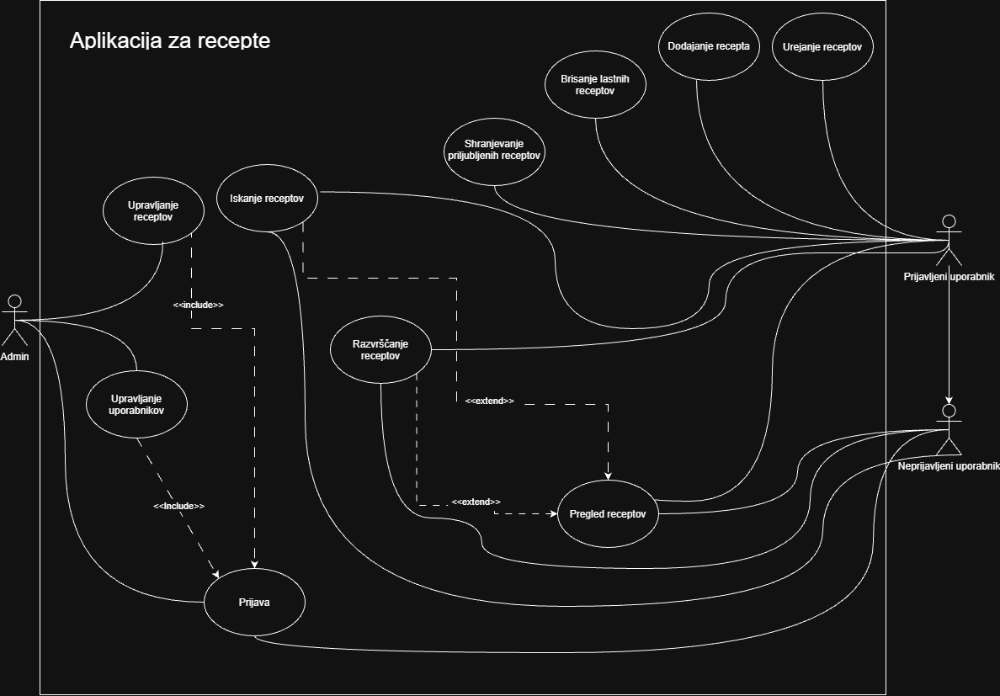

# AplikacijaRecepti – Tvoja kuhinja, tvoji recepti

## Člani skupine

- Anđela Pavlović
- Jovana Trajkova
- Niki Polanec

## 1. Vizija projekta

AplikacijaRecepti je namenjena vsem, ki radi kuhajo in želijo imeti svoje recepte shranjene na enem mestu. Namesto izpisov, zapiskov in razpršenih povezav uporabnik svojo zbirko receptov hitro pregleda, uredi in dopolni. Cilj aplikacije je, da je iskanje in priprava recepta čim enostavnejša.

### 1.1 Opis rešitve

AplikacijaRecepti je spletna aplikacija, v kateri uporabnik vodi svojo zbirko receptov. Vsak recept ima ime, opis, sestavine in čas priprave. Recepte lahko dodaja, ureja in briše, med njimi pa išče po imenu ter jih razvršča po imenu ali času priprave.

#### Ključne funkcionalnosti

- Dodajanje novih receptov.
- Pregled vseh shranjenih receptov.
- Urejanje obstoječih receptov.
- Brisanje receptov.
- Iskanje receptov po imenu.
- Razvrščanje receptov po imenu ali času priprave, naraščajoče ali padajoče.

### 1.2 Obseg rešitve in morebitne omejitve

Aplikacija pokriva osnovno upravljanje receptov (dodajanje, pregled, urejanje, brisanje, iskanje in razvrščanje). Zavedamo se naslednjih omejitev:

- Ni uporabniških računov, vsi uporabniki si delijo isto zbirko receptov.
- Sestavine so vpisane kot besedilo, ločeno z vejicami, brez količin in enot.
- Recepti nimajo slik, kategorij ali oznak.
- Iskanje deluje samo po imenu recepta.
- Aplikacija je trenutno namenjena lokalnemu zagonu, za delovanje morata teči frontend in backend ter podatkovna baza PostgreSQL.
- Uporabniški vmesnik je samo v slovenščini.

## 2. Besednjak

| Izraz | Pomen |
|---|---|
| Recept | Zapis jedi z imenom, opisom, sestavinami in časom priprave. Osnovna enota v aplikaciji. |
| Ime recepta | Naziv jedi, po katerem recept iščemo in razvrščamo. Obvezen podatek. |
| Opis recepta | Kratek opis jedi. Neobvezen podatek. |
| Sestavine | Seznam živil, ki jih potrebujemo za pripravo jedi. Vnesemo jih ločene z vejico, prikazane so kot seznam. Obvezen podatek. |
| Čas priprave | Čas, ki ga potrebujemo za pripravo jedi, izražen v minutah. Obvezen podatek. |
| Zbirka receptov | Vsi recepti, ki jih je uporabnik shranil v aplikaciji (v aplikaciji prikazana kot "Moji recepti"). |
| Kartica recepta | Prikaz posameznega recepta v zbirki z imenom, časom priprave, opisom in sestavinami. |
| Iskanje receptov | Filtriranje zbirke po imenu recepta. Velikost črk ni pomembna, dovolj je del imena. |
| Razvrščanje receptov | Urejanje zbirke po imenu recepta ali času priprave. |
| Vrstni red | Smer razvrščanja: naraščajoče (npr. od A do Ž, od najkrajšega časa) ali padajoče. |
| Privzeti vrstni red | Razvrstitev receptov po času dodajanja, torej tako, kot so bili shranjeni. |

## 3. Diagram primerov uporabe

Spodnji diagram prikazuje glavne primere uporabe aplikacije v načrtovani prihodnji različici.



Podrobni opisi vseh neimplementiranih primerov uporabe so na voljo v ločeni datoteki:

[Podrobni opisi neimplementiranih primerov uporabe](docs/vaja5/podrobni-opisi-neimplementiranih-funkcionalnosti.md)

## 4. O projektu

AplikacijaRecepti je spletna aplikacija za shranjevanje in upravljanje receptov. Uporabnik lahko dodaja nove recepte, pregleduje obstoječe, jih ureja in briše.

Vsak recept vsebuje ime, opis, sestavine in čas priprave. Aplikacija omogoča tudi iskanje receptov po imenu ter razvrščanje po imenu in času priprave.

Projekt je sestavljen iz frontenda, backenda in podatkovne baze PostgreSQL.

## 5. Uporabljene tehnologije

### 5.1 Frontend

- React 19.3.1 – knjižnica za izdelavo uporabniškega vmesnika.
- React DOM 19.3.1 – omogoča prikaz React komponent v brskalniku.
- JavaScript (ECMAScript) – programski jezik za razvoj frontend dela.
- Node.js 24.15.0 – izvajalno okolje za JavaScript.
- npm 11.12.1 – upravljanje paketov in odvisnosti.
- Vite 8.3.5 – orodje za razvoj in zagon frontend aplikacije (v `package.json` je navedeno `^8.3.4`).
- CSS – oblikovanje uporabniškega vmesnika.
- ESLint 10.13.0 – preverjanje kakovosti in pravilnosti kode.

### 5.2 Backend

- Java JDK 21.0.8 – programski jezik in razvojno okolje.
- Spring Boot 4.0.8 – ogrodje za razvoj backenda.
- Spring Data JPA – dostop do podatkovne baze in upravljanje podatkov.
- Spring Web MVC – izdelava REST API-ja.
- PostgreSQL 18.6 – sistem za upravljanje relacijske podatkovne baze.
- PostgreSQL JDBC Driver 42.7.13 – omogoča povezavo med aplikacijo Java in podatkovno bazo PostgreSQL.
- Apache Maven 3.10.0 – upravljanje odvisnosti in gradnja projekta.
- Maven Wrapper – omogoča uporabo ustrezne različice Maven orodja prek projekta.
- Springdoc OpenAPI 3.0.2 – generiranje dokumentacije REST API-ja.

Različici Spring Data JPA in Spring Web MVC upravlja Spring Boot prek svojega sistema za upravljanje odvisnosti.

### 5.3 Druga orodja

- IntelliJ IDEA 2025.2.3 – razvojno okolje za backend.
- Git 2.54.0 – sistem za upravljanje različic izvorne kode.
- GitHub – spletna platforma za shranjevanje kode in sodelovanje pri razvoju projekta.

## 6. Struktura projekta

Projekt je organiziran v dve glavni mapi: `backend` in `frontend`. V korenski mapi projekta se nahajajo tudi skupne konfiguracijske datoteke in dokumentacija.

```text
AplikacijaRecepti/
├── backend/
│   ├── .mvn/
│   │   └── wrapper/
│   ├── src/
│   │   ├── main/
│   │   │   ├── java/
│   │   │   │   └── si/um/feri/backend/
│   │   │   │       ├── controller/
│   │   │   │       │   └── RecipeController.java
│   │   │   │       ├── model/
│   │   │   │       │   └── Recipe.java
│   │   │   │       ├── repository/
│   │   │   │       │   └── RecipeRepository.java
│   │   │   │       └── BackendApplication.java
│   │   │   └── resources/
│   │   │       └── application.properties
│   │   └── test/
│   │       └── java/
│   │           └── si/um/feri/backend/
│   │               └── BackendApplicationTests.java
│   ├── mvnw
│   ├── mvnw.cmd
│   └── pom.xml
│
├── frontend/
│   ├── public/
│   ├── src/
│   │   ├── assets/
│   │   │   ├── hero.png
│   │   │   ├── react.svg
│   │   │   └── vite.svg
│   │   ├── App.jsx
│   │   ├── App.css
│   │   ├── index.css
│   │   └── main.jsx
│   ├── .gitignore
│   ├── eslint.config.js
│   ├── index.html
│   ├── package.json
│   ├── package-lock.json
│   ├── README.md
│   └── vite.config.js
│
├── docs/
│   └── vaja5/
│       ├── diagram-primera-uporabe.png
│       └── podrobni-opisi-neimplementiranih-funkcionalnosti.md
│
├── .gitignore
└── README.md
```

### 6.1 Backend

Mapa `backend` vsebuje zaledni del aplikacije, razvit v Javi s pomočjo Spring Boot.

- `backend/src/main/java/si/um/feri/backend` – vsebuje glavno Java kodo aplikacije.
- `controller` – vsebuje `RecipeController`, ki sprejema HTTP zahtevke in skrbi za komunikacijo s frontendom.
- `model` – vsebuje razred `Recipe`, ki predstavlja recept.
- `repository` – vsebuje `RecipeRepository`, ki omogoča dostop do podatkovne baze.
- `resources/application.properties` – vsebuje konfiguracijo aplikacije in povezavo s podatkovno bazo.
- `backend/src/test` – vsebuje testne datoteke.
- `pom.xml` – vsebuje odvisnosti in konfiguracijo Maven projekta.
- `mvnw` in `mvnw.cmd` – omogočata uporabo Maven Wrapperja.

### 6.2 Frontend

Mapa `frontend` vsebuje uporabniški vmesnik, razvit s knjižnico React.

- `frontend/public` – vsebuje javno dostopne datoteke.
- `frontend/src` – vsebuje izvorno kodo frontend aplikacije.
- `assets` – vsebuje slike in grafične datoteke.
- `App.jsx` – glavna komponenta uporabniškega vmesnika.
- `App.css` in `index.css` – vsebujeta stile aplikacije.
- `main.jsx` – vstopna točka React aplikacije.
- `package.json` – vsebuje podatke o projektu, odvisnosti in ukaze za zagon.
- `package-lock.json` – vsebuje natančne različice nameščenih paketov.
- `vite.config.js` – vsebuje konfiguracijo orodja Vite.
- `eslint.config.js` – vsebuje konfiguracijo orodja ESLint.

### 6.3 Dokumentacija

Mapa `docs/vaja5` vsebuje dokumentacijo, pripravljeno za peto vajo:

- `diagram-primera-uporabe.png` – diagram primerov uporabe.
- `podrobni-opisi-neimplementiranih-funkcionalnosti.md` – podrobni opisi še neimplementiranih primerov uporabe.

V korenski mapi se nahajata tudi `.gitignore`, ki določa datoteke in mape, ki jih Git ne vključuje v repozitorij, in `README.md` z dokumentacijo projekta.

## 7. Navodila za nameščanje in zagon

### 7.1 Predpogoji

Za namestitev in zagon projekta potrebujemo:

- Java JDK 21.
- Node.js 24 in npm 11.
- PostgreSQL 18.
- Git.

### 7.2 Prenos projekta

Projekt prenesemo iz GitHub repozitorija:

```bash
git clone https://github.com/jtrajkova11/AplikacijaRecepti.git
```

Nato odpremo glavno mapo projekta:

```bash
cd AplikacijaRecepti
```

### 7.3 Nastavitev podatkovne baze

Najprej zaženemo PostgreSQL in ustvarimo podatkovno bazo z imenom `recepti_db`.

Povezava s podatkovno bazo je nastavljena v datoteki `backend/src/main/resources/application.properties`:

```properties
spring.datasource.url=jdbc:postgresql://localhost:5432/recepti_db
spring.datasource.username=postgres
spring.datasource.password=${DB_PASSWORD}
```

Geslo za PostgreSQL nastavimo z okoljsko spremenljivko. V PowerShellu izvedemo:

```powershell
$env:DB_PASSWORD="your_postgresql_password"
```

Namesto `your_postgresql_password` vnesemo svoje geslo za PostgreSQL.

### 7.4 Zagon backenda

V prvem terminalu odpremo mapo `backend`:

```powershell
cd backend
```

Nastavimo okoljsko spremenljivko `DB_PASSWORD` in zaženemo backend:

```powershell
$env:DB_PASSWORD="your_postgresql_password"
.\mvnw.cmd spring-boot:run
```

Backend se zažene na naslovu:

`http://localhost:8080`

REST API je dostopen na naslovu:

[http://localhost:8080/api/recipes](http://localhost:8080/api/recipes)

Dokumentacija API-ja (Swagger UI):

[http://localhost:8080/swagger-ui/index.html](http://localhost:8080/swagger-ui/index.html)

### 7.5 Zagon frontenda

V drugem terminalu odpremo mapo `frontend`:

```powershell
cd frontend
```

Namestimo potrebne pakete:

```powershell
npm install
```

Zaženemo frontend aplikacijo:

```powershell
npm run dev
```

Frontend deluje na naslovu:

`http://localhost:5173`

Za pravilno delovanje aplikacije morata biti frontend in backend zagnana hkrati.

## 8. Navodila za razvijalce

Izvorna koda projekta je shranjena v GitHub repozitoriju:

[https://github.com/jtrajkova11/AplikacijaRecepti](https://github.com/jtrajkova11/AplikacijaRecepti)

Pri razvoju projekta uporabljamo Git in GitHub. Vsak član ekipe razvija in shranjuje svoje spremembe na svoji veji (branch), s čimer preprečimo neposredno prepisovanje kode drugih članov. Ko je posamezna naloga zaključena, razvijalec ustvari Pull Request, prek katerega se spremembe pregledajo in združijo v glavno vejo `main`.

### 8.1 Priprava razvojnega okolja

Najprej prenesemo projekt iz GitHub repozitorija:

```bash
git clone https://github.com/jtrajkova11/AplikacijaRecepti.git
```

Odpremo glavno mapo projekta:

```bash
cd AplikacijaRecepti
```

Preklopimo na glavno vejo in prenesemo najnovejše spremembe:

```bash
git switch main
git pull origin main
```

### 8.2 Ustvarjanje in uporaba lastne veje

Vsak član ekipe za svoje delo uporablja svojo vejo:

- Jovana: `feature/jovana`
- Niki: `feature/niki`
- Anđela: `feature/andjela`

**Ustvarjanje nove veje**

Če član svojo vejo ustvarja prvič, najprej posodobi glavno vejo `main`:

```bash
git switch main
git pull origin main
```

Nato ustvari svojo vejo. Primer za Jovanino vejo:

```bash
git switch -c feature/jovana
```

Novo vejo pošlje na GitHub in nastavi povezavo z oddaljeno vejo:

```bash
git push -u origin feature/jovana
```

Drugi člani uporabijo svoje ime veje (`feature/niki` ali `feature/andjela`).

**Uporaba že obstoječe veje**

Če veja že obstaja na GitHubu, je ne ustvarjamo ponovno. Preklopimo nanjo in prenesemo najnovejše spremembe.

Primer za Jovanino vejo:

```bash
git switch feature/jovana
git pull origin feature/jovana
```

Drugi člani uporabijo ime svoje veje.

Pred začetkom dela vedno preverimo, ali smo na pravilni veji:

```bash
git branch
```

Zvezdica (*) označuje trenutno aktivno vejo.

### 8.3 Shranjevanje in pošiljanje sprememb

Po končanem delu najprej preverimo stanje projekta:

```bash
git status
```

Dodamo datoteke, ki jih želimo vključiti v commit:

```bash
git add .
```

Ustvarimo commit z jasnim opisnim sporočilom:

```bash
git commit -m "Update recipe functionality"
```

Spremembe pošljemo na svojo vejo na GitHubu.

Primer za Jovanino vejo:

```bash
git push origin feature/jovana
```

Drugi člani uporabijo ime svoje veje. Pri naslednjih posodobitvah iste veje lahko uporabimo tudi:

```bash
git push
```

### 8.4 Pull Request in združevanje sprememb

Ko je delo na lastni veji zaključeno, spremembe predlagamo za združitev v glavno vejo `main` prek Pull Requesta.

Postopek:

1. Na GitHubu odpremo repozitorij projekta.
2. Izberemo možnost za ustvarjanje novega Pull Requesta.
3. Kot ciljno vejo (base) izberemo `main`.
4. Kot izvorno vejo (compare) izberemo svojo vejo, na primer `feature/jovana`.
5. Vpišemo naslov in kratek opis opravljenih sprememb.
6. Člani ekipe pregledajo spremembe in po potrebi predlagajo popravke.
7. Ko so spremembe pregledane, Pull Request združimo (merge) v vejo `main`.

Pred združitvijo je treba preveriti, ali so spremembe združljive z obstoječo kodo. Če pride do konflikta, ga je treba razrešiti, preden zaključimo združitev.

**Posodobitev lastne veje po združitvi Pull Requesta**

Ko so spremembe združene v `main`, posodobimo lokalno glavno vejo:

```bash
git switch main
git pull origin main
```

Nato se vrnemo na svojo delovno vejo in vanjo vključimo najnovejše spremembe iz `main`:

```bash
git switch feature/jovana
git merge main
```

Drugi člani namesto `feature/jovana` uporabijo ime svoje veje. Če pri združevanju pride do konflikta, ga razrešimo in nato shranimo ter pošljemo spremembe na GitHub.

### 8.5 Pravila sodelovanja

- Vsak član ekipe uporablja svoj GitHub račun in svojo delovno vejo.
- Vsak član spremembe najprej shrani na svojo vejo.
- Spremembe pošiljamo na GitHub v manjših, logično zaključenih commitih.
- Sporočila commitov naj jasno opisujejo opravljeno delo.
- Sprememb ne pošiljamo neposredno v vejo `main`.
- Pred združitvijo pregledamo spremembe v Pull Requestu.
- Pred začetkom nove naloge posodobimo lokalno vejo `main` in svojo delovno vejo.
- Gesel, ključev in drugih občutljivih podatkov ne dodajamo v Git repozitorij.
- Vsak član ekipe je odgovoren za preverjanje delovanja svojih sprememb.

## 9. Standardi kodiranja

Pri pisanju kode upoštevamo enotna pravila, da je projekt pregleden, razumljiv in enostaven za vzdrževanje.

### 9.1 Java

- Imena razredov zapisujemo v obliki PascalCase, npr. `RecipeController` in `RecipeRepository`.
- Imena metod in spremenljivk zapisujemo v obliki camelCase, npr. `getRecipeById` in `recipeName`.
- Imena paketov zapisujemo z malimi črkami.
- Vsak razred naj ima jasno določeno odgovornost.
- Kodo razdelimo na manjše in logično povezane metode.
- Uporabljamo razumljiva imena spremenljivk, metod in razredov.

### 9.2 JavaScript in React

- Imena React komponent zapisujemo z veliko začetnico, npr. `App`.
- Imena funkcij in spremenljivk zapisujemo v obliki camelCase, npr. `handleSubmit` in `recipeName`.
- Komponente naj bodo pregledne in naj imajo jasno določeno nalogo.
- JSX kodo zapisujemo pregledno in uporabljamo enotno zamikanje.
- Odstranimo neuporabljeno kodo in nepotrebne spremenljivke.
- Pri preverjanju kode uporabljamo ESLint.

### 9.3 Splošna pravila

- Uporabljamo enoten slog zapisovanja in zamikanja kode.
- Izbiramo jasna in opisna imena.
- Kodo razdelimo na logične in pregledne dele.
- Izogibamo se nepotrebnemu podvajanju kode.
- Spremembe preverimo pred pošiljanjem na GitHub.
- Gesel in drugih občutljivih podatkov ne zapisujemo neposredno v izvorno kodo ali javni GitHub repozitorij.